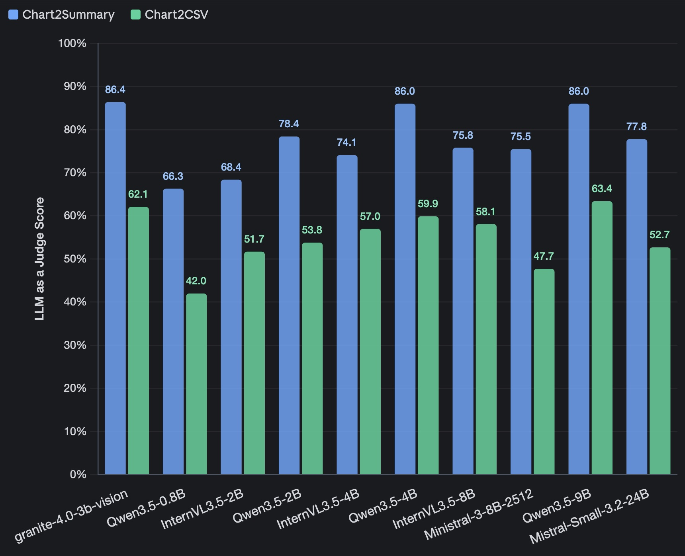
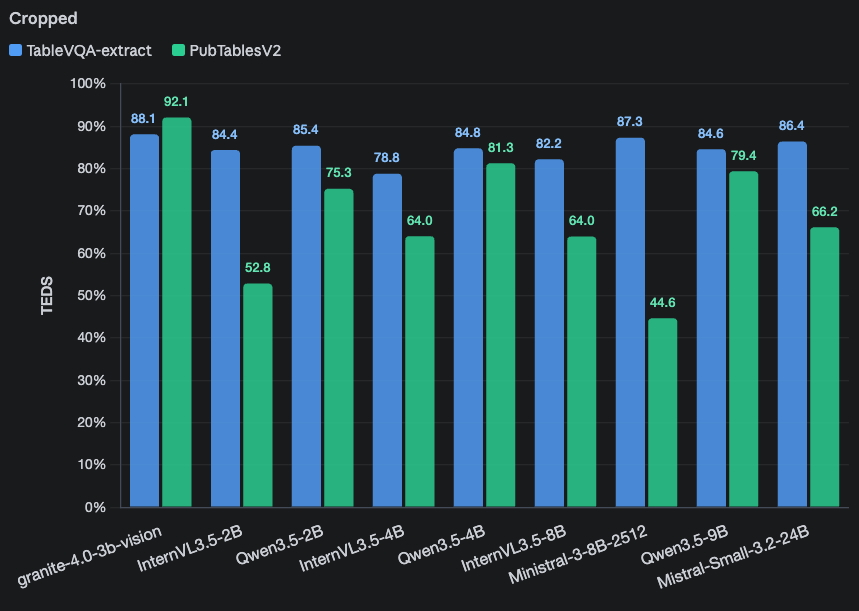
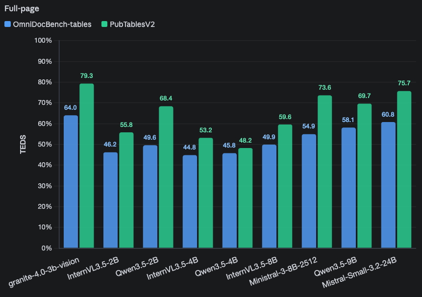

---
language:
- en
license: apache-2.0
pipeline_tag: image-text-to-text
new_version: ibm-granite/granite-vision-4.1-4b
tags:
- gguf
- mainframe
- s390x
- z15
- z16
- z17
- big-endian
base_model:
- ibm-granite/granite-4.0-3b-vision
base_model_relation: quantized
quantized_by: taronaeo
---

# Read our How to [Run on IBM Z & LinuxONE Guide!](https://github.com/ggml-org/llama.cpp/blob/master/docs/build-s390x.md)

<div>
<p style="margin: 0 0 0px 0; margin-top: 0px;">
<em>These models are byte-swapped to run on IBM Z & LinuxONE systems.</em>
</p>

<ul style="margin: 0;">
<li>Model Creator: <a href="https://huggingface.co/ibm-granite">IBM Granite</a></li>
<li>Original Model: <a href="https://huggingface.co/ibm-granite/granite-4.0-3b-vision">ibm-granite/granite-4.0-3b-vision</a></li>
</ul>
</div>

<br>

# Provided Files

Get started on your IBM Z & LinuxONE system

```sh
build/bin/llama-server -hf taronaeo/Granite-4.0-3B-Vision-BE-GGUF:Q4_K_M
```

| Name | Quant Method | Bits | Size | Use Case |
|---|---|---|---|---|
| [Granite-4.0-3B-Vision-BE-Q2_K.gguf](https://huggingface.co/taronaeo/Granite-4.0-3B-Vision-BE-GGUF/blob/main/Granite-4.0-3B-Vision-BE-Q2_K.gguf) | Q2_K | 2 | 1.4G | smallest K-quant, significant quality loss |
| [Granite-4.0-3B-Vision-BE-Q3_K_L.gguf](https://huggingface.co/taronaeo/Granite-4.0-3B-Vision-BE-GGUF/blob/main/Granite-4.0-3B-Vision-BE-Q3_K_L.gguf) | Q3_K_L | 3 | 1.8G | very small, high quality loss |
| [Granite-4.0-3B-Vision-BE-Q3_K_M.gguf](https://huggingface.co/taronaeo/Granite-4.0-3B-Vision-BE-GGUF/blob/main/Granite-4.0-3B-Vision-BE-Q3_K_M.gguf) | Q3_K_M | 3 | 1.7G | very small, high quality loss |
| [Granite-4.0-3B-Vision-BE-Q3_K_S.gguf](https://huggingface.co/taronaeo/Granite-4.0-3B-Vision-BE-GGUF/blob/main/Granite-4.0-3B-Vision-BE-Q3_K_S.gguf) | Q3_K_S | 3 | 1.6G | very small, high quality loss |
| [Granite-4.0-3B-Vision-BE-IQ4_NL.gguf](https://huggingface.co/taronaeo/Granite-4.0-3B-Vision-BE-GGUF/blob/main/Granite-4.0-3B-Vision-BE-IQ4_NL.gguf) | IQ4_NL | 4 | 2.0G | small, good quality for its size |
| [Granite-4.0-3B-Vision-BE-IQ4_XS.gguf](https://huggingface.co/taronaeo/Granite-4.0-3B-Vision-BE-GGUF/blob/main/Granite-4.0-3B-Vision-BE-IQ4_XS.gguf) | IQ4_XS | 4 | 1.9G | small, good quality for its size |
| [Granite-4.0-3B-Vision-BE-Q4_0.gguf](https://huggingface.co/taronaeo/Granite-4.0-3B-Vision-BE-GGUF/blob/main/Granite-4.0-3B-Vision-BE-Q4_0.gguf) | Q4_0 | 4 | 2.0G | legacy format, prefer Q4_K_M |
| [Granite-4.0-3B-Vision-BE-Q4_1.gguf](https://huggingface.co/taronaeo/Granite-4.0-3B-Vision-BE-GGUF/blob/main/Granite-4.0-3B-Vision-BE-Q4_1.gguf) | Q4_1 | 4 | 2.2G | legacy format, prefer Q4_K_M |
| [Granite-4.0-3B-Vision-BE-Q4_K_M.gguf](https://huggingface.co/taronaeo/Granite-4.0-3B-Vision-BE-GGUF/blob/main/Granite-4.0-3B-Vision-BE-Q4_K_M.gguf) | Q4_K_M | 4 | 2.1G | medium, balanced quality - recommended |
| [Granite-4.0-3B-Vision-BE-Q4_K_S.gguf](https://huggingface.co/taronaeo/Granite-4.0-3B-Vision-BE-GGUF/blob/main/Granite-4.0-3B-Vision-BE-Q4_K_S.gguf) | Q4_K_S | 4 | 2.0G | medium, balanced quality - recommended |
| [Granite-4.0-3B-Vision-BE-Q5_0.gguf](https://huggingface.co/taronaeo/Granite-4.0-3B-Vision-BE-GGUF/blob/main/Granite-4.0-3B-Vision-BE-Q5_0.gguf) | Q5_0 | 5 | 2.4G | legacy format, prefer Q5_K_M |
| [Granite-4.0-3B-Vision-BE-Q5_1.gguf](https://huggingface.co/taronaeo/Granite-4.0-3B-Vision-BE-GGUF/blob/main/Granite-4.0-3B-Vision-BE-Q5_1.gguf) | Q5_1 | 5 | 2.6G | legacy format, prefer Q5_K_M |
| [Granite-4.0-3B-Vision-BE-Q5_K_M.gguf](https://huggingface.co/taronaeo/Granite-4.0-3B-Vision-BE-GGUF/blob/main/Granite-4.0-3B-Vision-BE-Q5_K_M.gguf) | Q5_K_M | 5 | 2.4G | large, very low quality loss - recommended |
| [Granite-4.0-3B-Vision-BE-Q5_K_S.gguf](https://huggingface.co/taronaeo/Granite-4.0-3B-Vision-BE-GGUF/blob/main/Granite-4.0-3B-Vision-BE-Q5_K_S.gguf) | Q5_K_S | 5 | 2.4G | large, very low quality loss - recommended |
| [Granite-4.0-3B-Vision-BE-Q6_K.gguf](https://huggingface.co/taronaeo/Granite-4.0-3B-Vision-BE-GGUF/blob/main/Granite-4.0-3B-Vision-BE-Q6_K.gguf) | Q6_K | 6 | 2.8G | very large, extremely low quality loss |
| [Granite-4.0-3B-Vision-BE-Q8_0.gguf](https://huggingface.co/taronaeo/Granite-4.0-3B-Vision-BE-GGUF/blob/main/Granite-4.0-3B-Vision-BE-Q8_0.gguf) | Q8_0 | 8 | 3.6G | very large, extremely low quality loss |
| [Granite-4.0-3B-Vision-BE-BF16.gguf](https://huggingface.co/taronaeo/Granite-4.0-3B-Vision-BE-GGUF/blob/main/Granite-4.0-3B-Vision-BE-BF16.gguf) | BF16 | 16 | 6.8G | half precision, effectively lossless |
| [Granite-4.0-3B-Vision-BE-F16.gguf](https://huggingface.co/taronaeo/Granite-4.0-3B-Vision-BE-GGUF/blob/main/Granite-4.0-3B-Vision-BE-F16.gguf) | F16 | 16 | 6.8G | half precision, effectively lossless |
| [mmproj-Granite-4.0-3B-Vision-BE-F16.gguf](https://huggingface.co/taronaeo/Granite-4.0-3B-Vision-BE-GGUF/blob/main/mmproj-Granite-4.0-3B-Vision-BE-F16.gguf) | mmproj-F16 | 16 | 1.1G | multimodal projector |
| [Granite-4.0-3B-Vision-BE-F32.gguf](https://huggingface.co/taronaeo/Granite-4.0-3B-Vision-BE-GGUF/blob/main/Granite-4.0-3B-Vision-BE-F32.gguf) | F32 | 32 | 13.6G | full precision, largest |

---

# Granite 4.0 3B Vision

**Model Summary:**
Granite-4.0-3B-Vision is a vision-language model (VLM) designed for enterprise-grade
document data extraction. It focuses on specialized, complex extraction tasks that
ultracompact models often struggle with:

- **Chart extraction:** Converting charts into structured, machine-readable formats (Chart2CSV, Chart2Summary, and Chart2Code)
- **Table extraction:** Accurately extracting tables with complex layouts from document images to JSON, HTML, or OTSL
- **Semantic Key-Value Pair (KVP) extraction:** Extracting values based on key names and descriptions across diverse document layouts

The model is delivered as a LoRA adapter on top of [Granite 4.0 Micro](https://huggingface.co/ibm-granite/granite-4.0-micro), with a 3.5B base LLM and 0.5B LoRA adapters. This enables a single
deployment to support both multimodal document understanding and text-only workloads —
the base model handles text-only requests without loading the adapter. See
[Model Architecture](#model-architecture) for details.

The methodology and data (ChartNet) used for this model are described in the paper [ChartNet: A Million-Scale, High-Quality Multimodal Dataset for Robust Chart Understanding](https://huggingface.co/papers/2603.27064).

While our focus is on specialized document extraction tasks, the current model preserves and extends the 
capabilities of Granite-Vision-3.3 2B, ensuring that existing users can adopt it seamlessly with no changes to their workflow. 
It continues to support vision‑language tasks such as producing detailed natural‑language descriptions from images (image‑to‑text).
The model can be used standalone and integrates seamlessly
with [Docling](https://github.com/DS4SD/docling) to enhance document processing pipelines
with deep visual understanding capabilities.

- **Developer:** IBM Research
- **GitHub Repository:** https://github.com/ibm-granite
- **Release Date:** March 27th, 2026
- **License:** [Apache 2.0](https://www.apache.org/licenses/LICENSE-2.0)

## Supported Tasks

The model supports specialized extraction tasks, each activated by a simple task tag in
the user message. The chat template automatically expands tags into the full prompt — no
need to write verbose instructions.

| Tag | Task | Output |
|-----|------|--------|
| `<chart2csv>` | Chart to CSV | CSV table with headers and numeric values |
| `<chart2code>` | Chart to Python code | Python code that recreates the chart |
| `<chart2summary>` | Chart to summary | Natural-language description of the chart |
| `<tables_json>` | Table extraction (JSON) | Structured JSON with dimensions and cells |
| `<tables_html>` | Table extraction (HTML) | HTML `<table>` markup |
| `<tables_otsl>` | Table extraction (OTSL) | OTSL markup with cell/merge tags |
| KVP (see prompt instructions below) | Schema based Key-Value pairs extraction | JSON with nested dictionaries and arrays |


## Model Performance

### Benchmark Results

We compare Granite-4.0-3B-Vision against leading small VLMs across multiple extraction
benchmarks. 

#### Chart Extraction

We evalute chart extraction using the human-verified test-set from [ChartNet](https://huggingface.co/datasets/ibm-granite/ChartNet).
The models are evaluated using LLM-as-a-judge (GPT4o) comparing the model prediction against the ground-truth.
We report the average scores 0-100 on chart2csv and chart2summary extraction tasks.

<div style="display: flex; gap: 10px;">
  
</div>

#### Table Extraction

To benchmark table extraction, we construct a unified evaluation suite spanning multiple datasets and settings to assess end-to-end table extraction capabilities of vision-language models:

1. **[TableVQA-Extract](https://arxiv.org/abs/2404.19205)** — Converts the original visual table QA benchmark into a cropped table extraction task.  
2. **[OmniDocBench-tables](https://arxiv.org/abs/2412.07626)** — A document parsing benchmark over diverse PDF types with detailed annotations for layout, text, formulas, and tables. We use the subset of pages that contain one or more tables to evaluate table extraction in full-page settings.  
3. **[PubTablesV2](https://arxiv.org/abs/2512.10888)** — A large-scale table extraction benchmark evaluated in both cropped-table and full-page document settings.

To unify evaluation, we replace each dataset’s original annotations (e.g., Q&A pairs) with a single instruction: *extract the table(s) from the image in HTML format*, using the corresponding HTML as ground truth. For full-page inputs, only tabular elements are considered; when multiple tables appear, they are aggregated into a Python list.

We report results using **TEDS** ([Tree-Edit Distance-based Similarity](https://arxiv.org/abs/2208.00385)), which measures structural and content similarity between predicted and ground-truth HTML tables.

Results are presented separately for cropped-table and full-page settings to highlight performance across controlled and realistic document scenarios.

<div style="display: flex; gap: 10px;">
  
</div>
<div style="display: flex; gap: 10px;">
  
</div>

#### Key-Value Pair (KVP) Extraction
We evaluate on [VAREX](https://udibarzi.github.io/varex-bench/), a benchmark for
multimodal structured extraction from documents. Granite-4.0-3B-Vision achieves
85.5% exact-match accuracy (zero-shot), ranking 3rd among 2–4B
parameter models as of March 2026 (view results [here](https://udibarzi.github.io/varex-bench/#leaderboard)).

### Setup

Tested with python=3.11
```shell
pip install torch==2.10.0 --index-url https://download.pytorch.org/whl/cu128
pip install transformers==4.57.6 peft==0.18.1 tokenizers==0.22.2 pillow==12.1.1
```

## Usage with Transformers


```python
import re
from io import StringIO

import pandas as pd
import torch
from transformers import AutoProcessor, AutoModelForImageTextToText
from PIL import Image
from huggingface_hub import hf_hub_download

model_id = "ibm-granite/granite-4.0-3b-vision"
device = "cuda" if torch.cuda.is_available() else "cpu"

processor = AutoProcessor.from_pretrained(model_id, trust_remote_code=True)
model = AutoModelForImageTextToText.from_pretrained(
    model_id,
    trust_remote_code=True,
    dtype=torch.bfloat16,
    device_map=device
).eval()

# Optional: merge LoRA adapters into base weights for faster inference.
# Prefer to skip when using text-only tasks, as the LoRA adapters are vision-specific.
model.merge_lora_adapters()

def run_inference(model, processor, images, prompts):
    """Run batched inference on image+prompt pairs (one image per prompt)."""
    conversations = [
        [{"role": "user", "content": [
            {"type": "image"},
            {"type": "text", "text": prompt},
        ]}]
        for prompt in prompts
    ]
    texts = [
        processor.apply_chat_template(conv, tokenize=False, add_generation_prompt=True)
        for conv in conversations
    ]
    inputs = processor(
        text=texts, images=images, return_tensors="pt", padding=True, do_pad=True
    ).to(model.device)
    outputs = model.generate(
        **inputs,
        max_new_tokens=4096, 
        use_cache=True
    )
    results = []
    for i in range(len(prompts)):
        gen = outputs[i, inputs["input_ids"].shape[1]:]
        results.append(processor.decode(gen, skip_special_tokens=True))
    return results


def display_table(text):
    """Pretty-print CSV (possibly wrapped in ```csv```) or HTML table content via pandas."""
    m = re.search(r"```csv\s*
(.*?)```", text, re.DOTALL)
    if m:
        df = pd.read_csv(StringIO(m.group(1)))
        print(df.to_string(index=False))
    elif "<table" in text.lower():
        df = pd.read_html(StringIO(text))[0]
        print(df.to_string(index=False))
    else:
        print(text)
```

### Chart and Table Tasks

Your can pass tags and the chat template handles the rest:

```python
chart_path = hf_hub_download(repo_id=model_id, filename="chart.jpg")
table_path = hf_hub_download(repo_id=model_id, filename="table.png")
chart_img = Image.open(chart_path).convert("RGB")
table_img = Image.open(table_path).convert("RGB")

# Batched chart tasks
chart_prompts = ["<chart2csv>", "<chart2summary>", "<chart2code>"]
chart_results = run_inference(model, processor, [chart_img] * len(chart_prompts), chart_prompts)
for prompt, result in zip(chart_prompts, chart_results):
    print(f"{prompt}:")
    display_table(result)
    print()

# Batched table tasks
table_prompts = ["<tables_html>", "<tables_otsl>"]
table_results = run_inference(model, processor, [table_img] * len(table_prompts), table_prompts)
for prompt, result in zip(table_prompts, table_results):
    print(f"{prompt}:")
    display_table(result)
    print()
```

### Key-Value Pair Extraction (KVP)

For KVP extraction use the [VAREX](https://github.com/udibarzi/varex-bench) prompt format. Provide a JSON Schema describing the fields to extract and the model will return a JSON object with the extracted values.

```python
import json

invoice_path = hf_hub_download(repo_id=model_id, filename="invoice.png")
invoice_img = Image.open(invoice_path).convert("RGB")
schema = {
    "type": "object",
    "properties": {
        "invoice_date": {"type": "string", "description": "The date the invoice was issued"},
        "order_number": {"type": "string", "description": "The unique identifier for the order"},
        "seller_tax_id": {"type": "string", "description": "The tax identification number of the seller"},
    }
}

prompt = f"""Extract structured data from this document.
Return a JSON object matching this schema:

{json.dumps(schema, indent=2)}

Return null for fields you cannot find.
Return ONLY valid JSON.
Return an instance of the JSON with extracted values, not the schema itself."""

result = run_inference(model, processor, [invoice_img], [prompt])[0]
print(result)
```


## Usage with vLLM

This model includes a custom vLLM implementation (`granite4_vision.py`) and a server launcher
(`start_granite4_vision_server.py`) that register the model using vLLM's
[out-of-tree model integration](https://docs.vllm.ai/en/v0.5.3/models/adding_model.html#out-of-tree-model-integration)—no need to build vLLM from source.

```bash
pip install vllm
export LD_LIBRARY_PATH=$CONDA_PREFIX/lib:$LD_LIBRARY_PATH
```

Download `granite4_vision.py` and `start_granite4_vision_server.py` from this repo.
```bash
hf download ibm-granite/granite-4.0-3b-vision granite4_vision.py . 
hf download ibm-granite/granite-4.0-3b-vision start_granite4_vision_server.py .
```

Then, from the directory containing the downloaded files, you can start the server.

## Serving Modes with vLLM

#### Full merge (adapter merged at load time)

All LoRA deltas are merged into the base weights at load time. This gives the fastest inference, as every request uses the merged model.

```bash
python start_granite4_vision_server.py \
    --model ibm-granite/granite-4.0-3b-vision \
    --trust_remote_code --host 0.0.0.0 --port 8000 \
    --hf-overrides '{"adapter_path": "ibm-granite/granite-4.0-3b-vision"}'
```

#### Native LoRA runtime

vLLM applies the LM LoRA dynamically per request. Text-only prompts use the pure base model, while image prompts apply the LoRA adapter at inference time.

```bash
python start_granite4_vision_server.py \
    --model ibm-granite/granite-4.0-3b-vision \
    --trust_remote_code --host 0.0.0.0 --port 8000 \
    --enable-lora --max-lora-rank 256 \
    --default-mm-loras '{"image": "ibm-granite/granite-4.0-3b-vision"}'
```

### Client example

Query the running server using the OpenAI-compatible API:

```python
import base64
from openai import OpenAI
from huggingface_hub import hf_hub_download
from PIL import Image

model_id = "ibm-granite/granite-4.0-3b-vision"
client = OpenAI(base_url="http://localhost:8000/v1", api_key="EMPTY")

def run_inference(client, model_id, image_path, tag):
    with open(image_path, "rb") as f:
        image_b64 = base64.b64encode(f.read()).decode("utf-8")
    messages = [
        {"role": "user", "content": [
            {"type": "image_url", "image_url": {"url": f"data:image/png;base64,{image_b64}"}},
            {"type": "text", "text": tag},
        ]}
    ]
    response = client.chat.completions.create(
        model=model_id, messages=messages, max_tokens=4096, temperature=0,
    )
    return response.choices[0].message.content

chart_path = hf_hub_download(repo_id=model_id, filename="chart.jpg")
table_path = hf_hub_download(repo_id=model_id, filename="table.png")

# Chart tasks
for tag in ["<chart2csv>", "<chart2summary>", "<chart2code>"]:
    result = run_inference(client, model_id, chart_path, tag)
    print(f"{tag}:
{result}
")

# Table tasks
for tag in ["<tables_json>", "<tables_html>", "<tables_otsl>"]:
    result = run_inference(client, model_id, table_path, tag)
    print(f"{tag}:
{result}
")
```


## Training Data

The model was fine-tuned on a curated mixture of extraction-focused datasets spanning
chart understanding, complex table parsing, and document KVP extraction, supplemented
by the general-purpose [Granite Vision instruction-following dataset](https://arxiv.org/abs/2502.09927) for broad visual understanding.

Chart understanding data was created through a novel code‑guided augmentation methodology that produces diverse, 
semantically aligned chart samples containing rendering code, chart images, underlying data CSVs, and natural‑language summaries. 
Using this pipeline, we are also releasing [ChartNet](https://huggingface.co/datasets/ibm-granite/ChartNet), a comprehensive million‑scale multimodal dataset enriched with real‑world, 
human‑annotated, safety, and grounding subsets. The dataset and its methodology are detailed in the paper [ChartNet: A Million-Scale, High-Quality Multimodal Dataset for Robust Chart Understanding](https://huggingface.co/papers/2603.27064).

## Model Architecture

1. **SigLIP2 Vision encoder:** `google/siglip2-so400m-patch16-384`. Input images are tiled into 384×384 patches (with a base downscaled view always included), and each tile is encoded independently.
2. **Window Q-Former projectors:** Visual features are compressed 4× using windowed Q-Former projectors: each 4×4 patch window is reduced to 2×2 tokens via cross-attention, where the queries are initialized from a downsampled version of the window features. This reduces the visual token count fed to the LLM.
3. **Feature injection:** A variant of [Deepstack](https://arxiv.org/abs/2406.04334) where visual features are additively injected into the LLM hidden states at multiple layers through two complementary mechanisms:
   - *LayerDeepstack:* Features from 4 vision encoder depths are each projected and injected into a different LLM layer. The Q-Former queries are initialized from downsampled features. The mapping is reversed — the deepest (most semantic) vision features feed the earliest LLM layers, providing strong semantic grounding from the start.
   - *SpatialDeepstack:* The deepest vision features at full resolution are split into 4 complementary spatial groups. Each group's Q-Former queries are initialized from the corresponding spatial subset, and injected at a separate later LLM layer, providing fine-grained spatial detail.

   In total, **8 vision-to-LLM injection points** distribute visual information across the network for stronger visual grounding.
4. **Language model:** Granite 4.0 Micro (3B) with LoRA (rank 256) across all self-attention projections and MLP layers.

**Supported input:** English instructions and images (PNG, JPEG).


## Infrastructure

Granite 4.0 Vision was trained on IBM's Blue Vela supercomputing cluster, outfitted with
NVIDIA H100 GPUs. The training was done on 32 GPUs for approximately 200 hours.


## Ethical Considerations and Limitations

The use of vision-language models involves certain risks that should be considered before
deployment:
- **Task scope:** The model is specifically designed for structured extraction tasks and
  may not generalize well to open-ended vision-language tasks.
- **Hallucination:** As with all generative models, outputs should be validated before
  use in automated pipelines, particularly for high-stakes document processing.
- **Language:** The model is trained on English instructions only and may produce
  degraded results for documents in other languages.

To enhance safety in enterprise deployments, we recommend using Granite 4.0 Vision
alongside [Granite Guardian](https://huggingface.co/ibm-granite/granite-guardian-3.2-5b),
a model designed to detect and flag risks in inputs and outputs across key dimensions
outlined in the IBM AI Risk Atlas.


## Resources
- ⭐️ Learn about the latest updates with Granite: https://www.ibm.com/granite
- 🚀 Get started with tutorials, best practices, and prompt engineering advice: https://www.ibm.com/granite/docs/
- 💡 Granite learning resources: https://ibm.biz/granite-learning-resources


## Citation

```bibtex
@misc{granite-4.0-3b-vision,
  title={Granite 4.0 Vision},
  author={IBM Granite Vision Team},
  year={2026},
  url={https://huggingface.co/ibm-granite/granite-4.0-3b-vision}
}

@article{kondic2026chartnet,
  title={ChartNet: A Million-Scale, High-Quality Multimodal Dataset for Robust Chart Understanding},
  author={Kondic, Jovana and Li, Pengyuan and Joshi, Dhiraj and Sanchez, Isaac and Wiesel, Ben and Abedin, Shafiq and Alfassy, Amit and Schwartz, Eli and Caraballo, Daniel and Cinar, Yagmur Gizem and Scheidegger, Florian and Ross, Steven I. and Weidele, Daniel Karl I. and Hua, Hang and Arutyunova, Ekaterina and Herzig, Roei and He, Zexue and Wang, Zihan and Yu, Xinyue and Zhao, Yunfei and Jiang, Sicong and Liu, Minghao and Lin, Qunshu and Staar, Peter and Lastras, Luis and Oliva, Aude and Feris, Rogerio},
  journal={arXiv preprint arXiv:2603.27064},
  year={2026}
}
```
